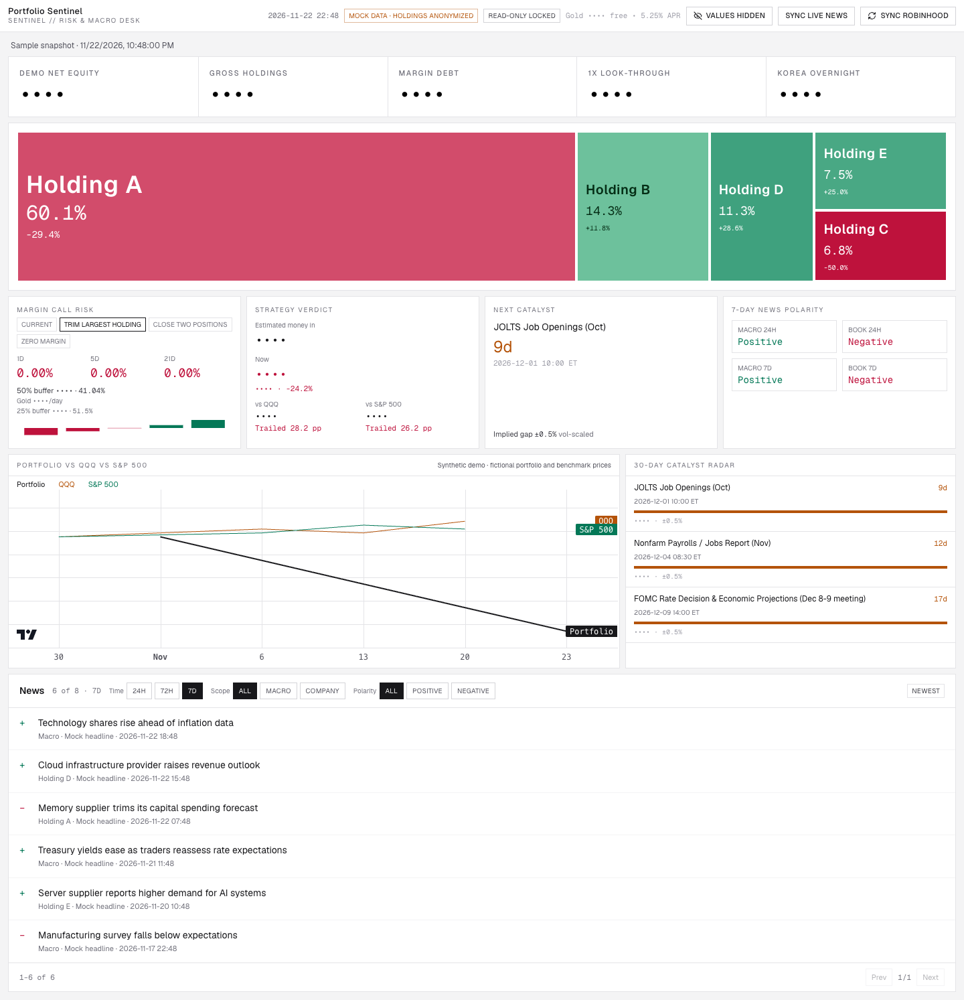
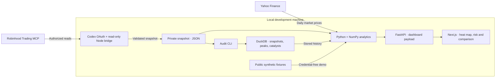

# Portfolio Sentinel

I built **Portfolio Sentinel** to better understand my own portfolio’s exposure to 2× leveraged technology ETFs. The read-only dashboard shows what drives that exposure, how modeled margin risk changes across scenarios, and how portfolio value compares with QQQ and the S&P 500 through SPY.

**The public demo uses fictional holdings, balances, and benchmark prices.** Run it locally without brokerage credentials.

## What the dashboard shows

- **Holdings and margin risk** — a heat map sized by holding weight, exposure estimates, and what-if scenarios.
- **Strategy verdict** — a hypothetical QQQ and SPY comparison using the same estimated starting capital.
- **Catalysts and news** — upcoming events, 7-day news polarity, and a headline feed filterable by time, scope, and polarity.

## Stack

| Layer | Tools |
| --- | --- |
| Frontend | Next.js, TypeScript, and Lightweight Charts |
| Backend and analytics | FastAPI, Python, NumPy, and DuckDB SQL |
| Data ingestion | Codex and Robinhood MCP for read-only accounts and positions, Yahoo Finance for daily benchmark prices |

## Dashboard demo



The screenshot shows mock holdings, benchmark series, and headlines. Holding names are anonymized and dollar values are hidden. The chart endpoint and the net equity tile reconcile to the same fictional value.

## Architecture



The public repository includes the fixture path and source code. Live snapshots, local database files, and OAuth stay on the machine running the dashboard.

## How the data moves

| Stage | Implementation |
| --- | --- |
| Ingest | A local Node.js bridge uses Codex-managed OAuth to page through Robinhood account and position data and select the freshest available quote. Yahoo Finance supplies daily adjusted prices for the live benchmarks. |
| Normalize | Python converts source records into a common positions snapshot, retains source timestamps, and atomically saves verified broker reads. Broker-reported net equity is carried through to the dashboard. |
| Store | The audit pipeline uses DuckDB and SQL to store position snapshots, high-water marks, and deduplicated news catalysts. |
| Analyze | Python and NumPy calculate concentration, leveraged look-through exposures, and simulated maintenance-threshold breaches under baseline and stress assumptions. |
| Present | FastAPI serves the analytics to a TypeScript and Next.js dashboard with a holdings heat map, benchmark chart, and read-only scenario controls. |

## Two decisions worth inspecting

- **Keep broker values distinct from market estimates.** Refreshing market quotes can update a valuation estimate while the broker snapshot remains intact. The benchmark chart uses the broker's reported net equity for its portfolio endpoint. The live QQQ and SPY paths assume a single investment of estimated starting capital because the brokerage deposit and withdrawal ledger is unavailable through the current connection.
- **Constrain and verify the agent integration.** The bridge calls an explicit list of read tools through Codex. The dataset, authorization, and account configuration stay local. Tests check stale-quote rejection, holding changes after a broker refresh, benchmark arithmetic, and deterministic margin scenarios.

The maintenance thresholds and simulated prices are model assumptions. The simulation is useful for comparing scenarios and does not reproduce the broker's margin model.

## Case study: fixing a stale portfolio after refresh

A browser reload originally reused the last saved positions, and a cached audit could still supply holdings after the saved book changed. Refreshing quotes alone could move an estimate while leaving the account balance and holdings stale. This mattered because the heat map and benchmark comparison could tell different stories about the same account.

I separated the broker snapshot from estimated market values and added a dedicated read-only Robinhood sync. A successful sync validates and atomically replaces the snapshot. The dashboard rebuilds the positions and heat map from that snapshot, reusing cached audit data for indicators only. The comparison chart takes its portfolio endpoint from the broker-reported equity.

I verified this at two levels. Regression tests check that stale quotes leave newer snapshot marks intact and that a sold position in an older audit never reappears. An authenticated local sync confirmed that the broker net equity, capital strip, and comparison endpoint agreed. The public fixture reproduces the reconciliation without using any personal values.

See [the refresh regression tests](tests/test_desk_refresh.py), [the broker bridge](scripts/robinhood-sync.mjs), and [the comparison math](src/desk.py).

## Run locally

Requires Python 3.11+ and Node.js 20.9+.

```sh
python3 -m venv .venv
.venv/bin/pip install -e '.[dev]'
npm --prefix web ci
./dev.sh
```

Open [the local dashboard](http://localhost:3000). The demo includes five anonymized synthetic holdings, both benchmark lines, and a mock news feed. Financial amounts and share counts start hidden. The visibility toggle can reveal the fictional amounts.

## Optional Robinhood sync

Authorize the official [Robinhood Trading MCP](https://robinhood.com/us/en/support/articles/onboarding-an-external-agent/) in a recent Codex CLI with app-server support.

```sh
codex mcp add robinhood-trading --url https://agent.robinhood.com/mcp/trading
```

Set `ROBINHOOD_ACCOUNT_LAST4` to your selected brokerage account's four-digit suffix in your local shell before running `./dev.sh`. Then click **Sync Robinhood**. The bridge uses an explicit allowlist of read tools. OAuth stays in Codex. Live snapshots and caches are stored locally and ignored by Git.

Keep the dashboard bound to loopback. Its visibility toggle masks values on screen. Local API responses contain portfolio values.

## Checks

```sh
.venv/bin/pytest -q
.venv/bin/sentinel smoke
```
